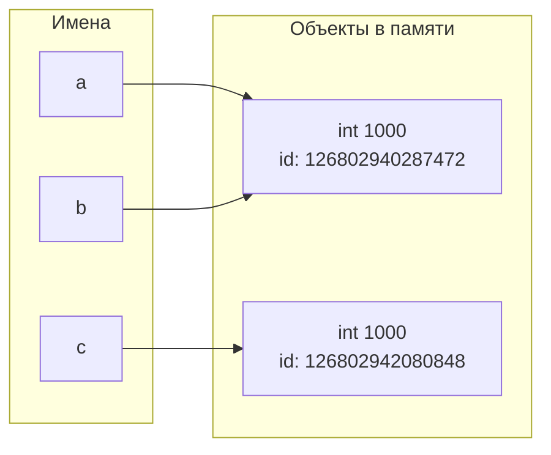

# Лабораторная работа № 1
## Выполнение программы, объекты и базовые типы Python

---

## Цель работы

Разобраться, как CPython выполняет программу, научиться отличать имя от объекта, корректно применять операции сравнения и работать с базовыми типами данных Python.

## Задачи

1. Изучить режимы запуска Python (REPL и скрипт) и проследить путь программы от исходного текста до байткода.
2. Исследовать связывание имен с объектами, разобраться с различиями между `==` и `is`.
3. Изучить числовые типы (`int`, `float`, `bool`, `complex`), арифметические операции и явные преобразования типов.
4. Освоить работу со строками: индексацию, срезы, Unicode и форматирование.
5. Создать программу, объединяющую все изученные конструкции.

## Ход работы

1. В первом задании я запустила одно и то же выражение в REPL и в `.py`-файле, сравнила поведение, разобрала код на выражения, инструкции, литералы и имена, а также изучила AST и байткод через модули `ast` и `dis`.
2. Во втором задании исследовала, как имена связываются с объектами, проверила прогнозы сравнений через `==` и `is`, построила схему связей, разобралась с синглтоном `None` и интернированием строк.
3. В третьем задании провела четыре мини-эксперимента: с арифметикой `int`, с большими целыми числами, с погрешностями `float` и с преобразованиями типов (`bool`, `complex`).
4. В четвертом задании работала со строками: брала срезы, разворачивала строки, форматировала вывод тремя способами, исследовала Unicode и столкнулась с неизменяемостью строк.
5. В пятом задании собрала всё вместе: написала программу с вводом данных, вычислениями и красивым выводом карточки эксперимента, а также проанализировала типы всех имен.

---

<!-- TOC -->
* [Лабораторная работа № 1](#лабораторная-работа--1)
  * [Выполнение программы, объекты и базовые типы Python](#выполнение-программы-объекты-и-базовые-типы-python)
  * [Цель работы](#цель-работы)
  * [Задачи](#задачи)
  * [Ход работы](#ход-работы)
  * [Задание 1. От исходного кода к байткоду](#задание-1-от-исходного-кода-к-байткоду)
    * [Часть 1. Режимы запуска](#часть-1-режимы-запуска)
    * [Часть 2. Выражения и инструкции](#часть-2-выражения-и-инструкции)
    * [Часть 3. AST и байткод](#часть-3-ast-и-байткод)
      * [Узлы в AST](#узлы-в-ast)
      * [В дизассемблированном коде](#в-дизассемблированном-коде)
    * [**Контрольный вопрос:**](#контрольный-вопрос)
    * [Приложение с полными выводами команд](#приложение-с-полными-выводами-команд)
  * [Задание 2. Имена, объекты и сравнение](#задание-2-имена-объекты-и-сравнение)
    * [Прогноз результатов](#прогноз-результатов)
    * [Фактические результаты](#фактические-результаты)
    * [1. Схема связей между именами и объектами](#1-схема-связей-между-именами-и-объектами)
    * [2. Разница между равенством значений и идентичностью объектов](#2-разница-между-равенством-значений-и-идентичностью-объектов)
    * [3. Проверка на `None`](#3-проверка-на-none)
    * [4. Эксперимент со строками](#4-эксперимент-со-строками)
    * [5. Правило применения `==` и `is`](#5-правило-применения--и-is)
    * [Контрольные вопросы](#контрольные-вопросы)
  * [Задание 3. Числовые типы, операции и преобразования](#задание-3-числовые-типы-операции-и-преобразования)
    * [Эксперимент A. `int` и арифметические операторы](#эксперимент-a-int-и-арифметические-операторы)
    * [Эксперимент B. Большие целые числа](#эксперимент-b-большие-целые-числа)
    * [Эксперимент C. `float`](#эксперимент-c-float)
    * [Эксперимент D. `bool`, `complex` и явное преобразование типов](#эксперимент-d-bool-complex-и-явное-преобразование-типов)
    * [Контрольные вопросы](#контрольные-вопросы-1)
  * [Задание 4. Строки, Unicode и форматирование](#задание-4-строки-unicode-и-форматирование)
    * [Результаты выполнения пунктов программы](#результаты-выполнения-пунктов-программы)
    * [Контрольные вопросы](#контрольные-вопросы-2)
  * [Задание 5. Информационная карточка вычислительного эксперимента](#задание-5-информационная-карточка-вычислительного-эксперимента)
    * [1. Типы имен в программе](#1-типы-имен-в-программе)
    * [2. Разбор одной арифметической строки](#2-разбор-одной-арифметической-строки)
    * [3. Путь программы от файла до выполнения](#3-путь-программы-от-файла-до-выполнения)
    * [4. Почему `input()` надо явно преобразовывать](#4-почему-input-надо-явно-преобразовывать)
    * [Контрольный вопрос](#контрольный-вопрос-1)
  * [Краткий вывод по всей лабораторной работе](#краткий-вывод-по-всей-лабораторной-работе)
<!-- TOC -->

## Задание 1. От исходного кода к байткоду

### Часть 1. Режимы запуска

***Вопрос:*** Почему в REPL результат отображается автоматически, а при запуске файла — нет?
Как изменить файл так, чтобы результат появился в терминале?

***Ответ:*** В режиме REPL (Read-Eval-Print Loop) по-умолчанию после вычисления любого выражения автоматически
вызывается функция отображения результата.\
При запуске .py-файла мы (интерпретатор) работаем в режиме скрипта: вычисляем выражение указанное выражение,
но поскольку результат не передается в print (), он просто отбрасывается == не сохраняется нигде.
Чтобы результат появился, необходимо явно использовать функцию print ().

### Часть 2. Выражения и инструкции

* Какие фрагменты являются выражениями:
    * **Выражения** -- фрагменты, которые возвращают значение при вычислении: `"Python"`, `4 * 2`,
      `f"{course}: {hours} часов".`
* Какие строки являются инструкциями:
    * **Инструкции** -- строки, выполняющие действие:
        * присваивание: `course = "Python"`, `
hours = 4 * 2`;
        * вызов функции: `print(...)`;
* Какие литералы присутствуют в программе:
    * **Литералы** -- конкретные значения, записанные в коде: `"Python"`, `4`, `2`, `"<...> : <...> часов"`;
* Какие имена создаются при выполнении программы:
    * **Имена** -- идентификаторы, создаваемые или используемые в программе: `course`, `hours`;

### Часть 3. AST и байткод

***Версия Python:***

```
$python --version
> Python 3.14.4
```

#### Узлы в AST

* ***Узлы в AST, соответствующие присваиванию***
    * ```python
      course = "Python"
      hours = 4 * 2
      ```
      ```jsonpath
              Assign(
                 targets=[
                    Name(id='course', ctx=Store())],
                 value=Constant(value='Python')), 
              Assign(
                 targets=[
                    Name(id='hours', ctx=Store())],
                 value=BinOp(
                    left=Constant(value=4),
                    op=Mult(),
                    right=Constant(value=2))),
          ```
* ***Узлы в AST, соответствующие арифметической операции***
    * ```python
      print("....",  2 + 3 * 4)
      hours = 4 * 2
      ```
      ```jsonpath
      BinOp(
                    left=Constant(value=2),
                    op=Add(),
                    right=BinOp(
                       left=Constant(value=3),
                       op=Mult(),
                       right=Constant(value=4)))
      
      BinOp(
              left=Constant(value=4),
              op=Mult(),
              right=Constant(value=2))
      ```
* ***Узлы в AST, соответствующие вызову print ()***
    * ```python
      print("....",  2 + 3 * 4)
      print(f"Часть 2. {course}: {hours} часов")
      ```
      ```jsonpath
        Expr(
          value=Call(
                  func=Name(id='print', ctx=Load()),
                  args=[
                     BinOp(
                        left=Constant(value=2),
                        op=Add(),
                        right=BinOp(
                           left=Constant(value=3),
                           op=Mult(),
                           right=Constant(value=4)))]))
      
        Expr(
           value=Call(
              func=Name(id='print', ctx=Load()),
              args=[
                 JoinedStr(
                    values=[
                       FormattedValue(
                          value=Name(id='course', ctx=Load()),
                          conversion=-1),
                       Constant(value=': '),
                       FormattedValue(
                          value=Name(id='hours', ctx=Load()),
                          conversion=-1),
                       Constant(value=' часов')])]))])
      ```

#### В дизассемблированном коде

* ***инструкции, отвечающие за загрузку константы***
    * ```
      3           LOAD_CONST               1 ('Python')
              STORE_NAME               1 (course)

      4           LOAD_SMALL_INT           8
                  STORE_NAME               2 (hours)
      ```
* ***инструкции, отвечающие за вызов функции***
    * ```
      1           LOAD_NAME                0 (print)
      ...

                  CALL                     1
                  POP_TOP
    
      ....    
      5           LOAD_NAME                0 (print)
      ...
                  CALL                     1
                  POP_TOP
      ```

### **Контрольный вопрос:**

_Почему байткод CPython нельзя считать машинным кодом процессора?_

**Ответ:** _Потому что байткод промежуточное состояние и будет работать на виртуальной машине питона.
Он не зависит от архитектуры конкретного "железа" как машинный код, который привязан к конкретному процессору и его
разрядости и прочего _

### Приложение с полными выводами команд

<details>
<summary><b>Полный вывод `python -m ast task_1.py`</b> (нажмите, чтобы развернуть)</summary>

```jsonpath
Module(
   body=[
      Expr(
         value=Call(
            func=Name(id='print', ctx=Load()),
            args=[
               BinOp(
                  left=Constant(value=2),
                  op=Add(),
                  right=BinOp(
                     left=Constant(value=3),
                     op=Mult(),
                     right=Constant(value=4)))])),
      Assign(
         targets=[
            Name(id='course', ctx=Store())],
         value=Constant(value='Python')),
      Assign(
         targets=[
            Name(id='hours', ctx=Store())],
         value=BinOp(
            left=Constant(value=4),
            op=Mult(),
            right=Constant(value=2))),
      Expr(
         value=Call(
            func=Name(id='print', ctx=Load()),
            args=[
               JoinedStr(
                  values=[
                     FormattedValue(
                        value=Name(id='course', ctx=Load()),
                        conversion=-1),
                     Constant(value=': '),
                     FormattedValue(
                        value=Name(id='hours', ctx=Load()),
                        conversion=-1),
                     Constant(value=' часов')])]))])
```

</details>

<details>
<summary><b>Полный вывод `python -m dis task_1.py`</b> (нажмите, чтобы развернуть)</summary>

```jsonpath
0           RESUME                   0

1           LOAD_NAME                0 (print)
            PUSH_NULL
            LOAD_SMALL_INT          14
            CALL                     1
            POP_TOP

3           LOAD_CONST               1 ('Python')
            STORE_NAME               1 (course)

4           LOAD_SMALL_INT           8
            STORE_NAME               2 (hours)

5           LOAD_NAME                0 (print)
            PUSH_NULL
            LOAD_NAME                1 (course)
            FORMAT_SIMPLE
            LOAD_CONST               2 (': ')
            LOAD_NAME                2 (hours)
            FORMAT_SIMPLE
            LOAD_CONST               3 (' часов')
            BUILD_STRING             4
            CALL                     1
            POP_TOP
            LOAD_CONST               4 (None)
            RETURN_VALUE
```

</details>

## Задание 2. Имена, объекты и сравнение

### Прогноз результатов
Перед запуском программы был сделан следующий прогноз:
- `a == b`: **True** — значения одинаковые (оба 1000).
- `a is b`: **True** — инструкция `b = a` связывает имя `b` с тем же объектом, на который ссылается `a`. 
-  `a == c`: **True** — значения одинаковые (оба 1000).
- `a is c`: **False** — объект `c` создан заново вызовом `int("1000")`.
  - Так как число 1000 не принадлежит [-5, 256] (диапазон кеширования малых целых чисел), то происходит создание нового объекта.  


### Фактические результаты
Прогноз полностью совпал с фактическим поведением программы. Расхождений нет.

### 1. Схема связей между именами и объектами



*Пояснение:* Имена `a` и `b` ссылаются на один и тот же объект `int(1000)`, потому что `b = a` не создает копию, а лишь добавляет еще одну ссылку. Имя `c` ссылается на другой объект с тем же значением, созданный независимо вызовом `int()`.

### 2. Разница между равенством значений и идентичностью объектов

- **`==` (равенство значений)** — проверяет, эквивалентны ли объекты по содержимому. Для чисел это означает совпадение их математического значения. Операция реализуется через метод `__eq__()`.
- **`is` (идентичность объектов)** — проверяет, ссылаются ли имена на **один и тот же объект в памяти**. По сути, это сравнение результатов `id()`. Операцию нельзя переопределить.

Объекты могут быть равны по значению (`==`), но не идентичны (`is`), как в случае с `a` и `c`.

### 3. Проверка на `None`

После изменения `c = None` корректная проверка выполняется так:

```python
c = None
print("c is None:", c is None)  # True
```

Использовать `is` для сравнения с `None` — это соглашение стиля Python (PEP 8), потому что `None` является синглтоном: в памяти существует ровно один объект `None`, и все имена, связанные с `None`, ссылаются на него.

### 4. Эксперимент со строками

```python
first = "python"
second = "py" + "thon"

print(first == second)  # True
print(first is second)  # True
```

**Объяснение:** В CPython при компиляции файла интерпретатор выполняет **peephole-оптимизацию** и **constant folding**: конкатенация двух строковых литералов `"py" + "thon"` вычисляется на этапе компиляции, а не в рантайме. В результате обе переменные ссылаются на один и тот же интернированный строковый объект `"python"` в памяти.

### 5. Правило применения `==` и `is`

- **`is`** применяется только для сравнения с синглтонами: `None`, `True`, `False`. Например: `if x is None:`.
- **`==`** применяется для сравнения значений всех остальных объектов: чисел, строк, списков и т.д.
- **Никогда** нельзя делать вывод о равенстве значений на основе совпадения `id()` — это деталь реализации (интернирование строк, кеш малых целых), которая может меняться между версиями CPython.

---

### Контрольные вопросы

**1. Создает ли инструкция `b = a` копию объекта?**  
Нет. Инструкция присваивания в Python не копирует объект. Она лишь связывает новое имя `b` с тем же объектом в памяти, на который уже ссылается имя `a`. В результате оба имени указывают на один объект, что подтверждается совпадением `id(a)` и `id(b)`.

**2. Что возвращают `type()` и `id()`?**  
- `type(obj)` возвращает объект типа, описывающий класс данного объекта (например, `<class 'int'>`).
- `id(obj)` возвращает целое число — уникальный идентификатор объекта в памяти. В CPython это адрес объекта в памяти, который остается неизменным на протяжении всего времени жизни объекта.

**3. Почему `None` принято сравнивать с помощью `is`, а числа и строки — с помощью `==`?**  
`None` в Python — это синглтон, в интерпретаторе существует ровно один экземпляр объекта `None`. Поэтому сравнение через `is` (проверка идентичности) работает корректно, быстрее, чем `==`, и явно выражает намерение программиста: "проверить, что переменная ссылается именно на объект None". Числа и строки могут иметь одинаковое значение, но быть разными объектами (как `a` и `c` в эксперименте), поэтому для них единственно корректный способ сравнения — `==`.

## Задание 3. Числовые типы, операции и преобразования

### Эксперимент A. `int` и арифметические операторы

**Результаты:**

| Операция | Значение | Тип результата |
| :--- | :--- | :--- |
| `x + y`  | 22 | `int` |
| `x - y`  | 12 | `int` |
| `x * y`  | 85 | `int` |
| `x / y`  | 3.4 | `float` |
| `x // y` | 3 | `int` |
| `x % y`  | 2 | `int` |
| `x ** y` | 1419857 | `int` |


**Почему `/` и `//` возвращают разные значения и типы:**
- Оператор `/` — это **истинное деление** (true division). Он всегда возвращает `float`, даже если числа делятся нацело, чтобы сохранить математическую точность результата. `17 / 5 = 3.4`.
- Оператор `//` — это **целочисленное деление** (floor division). Он отбрасывает дробную часть. Для двух `int` возвращает `int`. `17 // 5 = 3`.

### Эксперимент B. Большие целые числа

**Результат:** `2 ** 1000` вычисляется без ошибок и возвращает число, содержащее **302 цифры**.

**Отличие от языков с фиксированной разрядностью:**
В языках вроде C, Java или Go тип `int` имеет фиксированный размер (обычно 32 или 64 бита). При превышении максимально допустимого значения происходит **переполнение** (overflow) — число "зацикливается" и становится некорректным (так если к MAX_INT прибавить 1 получиться -MAX_INT). В Python тип `int` имеет **произвольную точность**: интерпретатор автоматически выделяет столько памяти, сколько нужно для хранения числа. Переполнение в Python невозможно — результатом будет корректное большое целое число любой длины.

### Эксперимент C. `float`

**Результаты:**
- `0.1 + 0.2` = `0.30000000000000004`
- `result == 0.3` = `False`
- `result - 0.3` = `5.551115123125783e-17`
- `math.isclose(result, 0.3)` = `True`

**Объяснение:**
Числа с плавающей точкой в Python (как и во всех современных языках) следуют стандарту **IEEE 754** и хранятся в двоичной системе. Дроби `0.1` и `0.2` в двоичной системе являются **бесконечными периодическими** (аналогично тому, как `1/3 = 0.333...` в десятичной). При их сложении накапливается микроскопическая погрешность, которая и приводит к результату `0.30000000000000004` вместо точного `0.3`.

**Правило безопасного сравнения `float`:**
Никогда не использовать `==` для сравнения вещественных чисел. Вместо этого применять:
- `math.isclose(a, b)` — сравнивает с учетом допустимой погрешности (рекомендуется).
- `abs(a - b) < epsilon`, где `epsilon` — малое число (например, `1e-9`).

### Эксперимент D. `bool`, `complex` и явное преобразование типов

**Результаты:**

| Выражение | Значение | Тип |
| :--- | :--- | :--- |
| `int("42")` | 42 | `int`  |
| `float("3.14")`    | 3.14 | `float`|
| `str(2026)` | "2026" | `str`  |
| `bool(0)` | False | `bool` |
| `bool(-1)` | True | `bool` |
| `bool("")` | False | `bool` |
| `bool("False")` | True | `bool` |
| `complex(2, -3)` | (2-3j) | `complex`|

Для комплексного числа `c = complex(2, -3)`:
- Действительная часть (`c.real`): `2.0`
- Мнимая часть (`c.imag`): `-3.0`

**Почему `bool("False")` дает `True`:**
Функция `bool()` для строк проверяет только **длину строки**, а не её содержимое. Любая непустая строка считается "истинной" (truthy), даже если внутри неё написано слово `"False"`. Пустая строка `""` — единственная строка, которая даёт `False`.

---

### Контрольные вопросы

**1. Почему результат обычного деления двух объектов `int` имеет тип `float`?**  
Это осознанный дизайн Python 3. Оператор `/` всегда возвращает `float`, чтобы избежать неожиданной потери точности. Например, `5 / 2` должно дать `2.5`, а не `2`. Если программисту нужно именно целочисленное деление, он явно использует оператор `//`. В Python 2 поведение было другим (`/` для `int` давал `int`), что приводило к частым ошибкам, поэтому в Python 3 это исправили.

**2. В чем отличие преобразования `int("42")` от `int(42.9)`?**  
Это два принципиально разных действия:
- `int("42")` — **парсинг строки**: интерпретатор читает текстовое представление числа и преобразует его в числовой объект. Если строка не является валидным числом (например, `"42abc"`), будет вызвано исключение `ValueError`.
- `int(42.9)` — **усечение (truncation)**: у вещественного числа просто отбрасывается дробная часть. Результат — `42`. Округления не происходит (для округления используется `round()`).

**3. Какие значения из эксперимента D являются falsy?**  
Falsy-значения (те, что при приведении к `bool` дают `False`):
- `bool(0)` → `False` (ноль — единственное falsy-число).
- `bool("")` → `False` (пустая строка — единственная falsy-строка).

Все остальные значения (`-1`, `"False"`, ненулевые числа, непустые строки) являются truthy.


## Задание 4. Строки, Unicode и форматирование

### Результаты выполнения пунктов программы

**1. Первый и последний символ:**
- Первый символ (`student[0]`): `А`
- Последний символ (`student[-1]`): `а`

**2. Срезы с именем и фамилией:**
- Имя (`student[:4]`): `Анна` (символы с индекса 0 по 3 включительно).
- Фамилия (`student[5:]`): `Смирнова` (символы с индекса 5 до конца строки).

**3. Регистры:**
- Верхний: `АННА СМИРНОВА`
- Нижний: `анна смирнова`

**4. Инициалы:**
Созданы конкатенацией символов по индексам: `student[0] + "." + student[5] + "."`
Результат: `А.С.`

**5. Обратный порядок:**
Срез с шагом `-1` (`course[::-1]`) разворачивает строку:
`nohtyP ан яинавориммаргорп ывонсО`

**6. Форматирование строки (все три способа дали одинаковый результат):**
`Анна Смирнова — Основы программирования на Python: 7/10 (70.0%)`

**7. Исследование Unicode для символа "Я":**
- Код символа (`ord()`): `1071`
- Восстановленный символ (`chr()`): `Я`
- Представление в UTF-8: `b'\xd0\xaf'`
- Длина байтовой последовательности: `2`

**8. Попытка изменения строки:**
При выполнении инструкции `student[0] = 'О'` возникает ошибка:
`TypeError: 'str' object does not support item assignment`

**Причина:** Строки в Python являются **неизменяемыми (immutable)** объектами. После создания строки изменить отдельный символ по индексу невозможно. Для получения измененной строки нужно создавать новый объект (например, с помощью срезов или методов).

---

### Контрольные вопросы

**1. Почему `len(symbol)` и `len(symbol.encode("utf-8"))` могут различаться?**
- `len(symbol)` возвращает количество **символов** (Unicode code points) в строке. Для символа `"Я"` это `1`.
- `len(symbol.encode("utf-8"))` возвращает количество **байт**, необходимых для хранения этих символов в кодировке UTF-8. Кириллические символы в UTF-8 занимают по 2 байта, поэтому длина байтового представления равна `2`.

**2. Что означают границы и шаг в записи `text[start:stop:step]`?**
- `start` — индекс начала среза (включительно). По умолчанию `0` (или конец, если шаг отрицательный).
- `stop` — индекс конца среза (**не включительно**). По умолчанию длина строки (или начало, если шаг отрицательный).
- `step` — шаг выборки символов. По умолчанию `1`. Если `step` отрицательный (например, `-1`), срез идет в обратном направлении.

**3. Почему строка считается неизменяемым объектом, хотя методы вроде `.upper()` возвращают измененный текст?**
Методы строк (такие как `.upper()`, `.lower()`, `.replace()`) **не модифицируют исходный объект в памяти**. Вместо этого они создают и возвращают **новый объект** `str` с нужными изменениями, оставляя исходную строку нетронутой.

## Задание 5. Информационная карточка вычислительного эксперимента

### 1. Типы имен в программе

После выполнения программы имена связаны с такими типами:

- `researcher` — `str` (то, что вернул `input()`)
- `experiment_name` — `str`
- `runs` — `int` (явно преобразовали через `int()`)
- `duration_sec` — `float`
- `real_part`, `imag_part` — `float`
- `total_sec` — `float` (получился при умножении `int * float`)
- `total_min` — `float`
- `coeff` — `complex`
- `mod_sq` — `float` (возведение `float` в степень дает `float`)
- `has_runs` — `bool`

### 2. Разбор одной арифметической строки

Возьмем для примера строку:
```python
mod_sq = real_part ** 2 + imag_part ** 2
```

- **Имена**: `mod_sq`, `real_part`, `imag_part`
- **Литералы**: `2`
- **Операторы**: `=` (присваивание), `**` (степень), `+` (сложение)
- **Вызовы функций**: нет

По сути, интерпретатор берет значения `real_part` и `imag_part`, возводит каждое в квадрат, складывает результаты и связывает получившееся число с именем `mod_sq`.

### 3. Путь программы от файла до выполнения

Когда мы запускаем `python task_5.py`, происходит примерно следующее:

1. Интерпретатор читает текстовый файл `task_5.py`.
2. Лексер разбивает текст на токены, парсер проверяет синтаксис и строит AST (абстрактное синтаксическое дерево).
3. Компилятор Python превращает AST в байткод — набор инструкций для своей виртуальной машины.
4. Виртуальная машина CPython (eval loop) по очереди читает инструкции байткода, крутит стек, выделяет объекты в памяти и выполняет операции.

Именно поэтому Python-код работает одинаково на Windows, Linux и macOS — байткод не привязан к железу.

### 4. Почему `input()` надо явно преобразовывать

Потому что `input()` **всегда** возвращает строку (`str`), что бы пользователь ни ввел. Если попробовать посчитать `"5" + "5"`, получится `"55"` (конкатенация), а не `10`. А если попробовать `"5" * "5"` — вообще упадет с `TypeError`, потому что умножение строки на строку не определено. Поэтому перед арифметикой нужно явно превращать ввод в `int` или `float`.

---

### Контрольный вопрос

**Что изменится на уровне объектов и связывания имен при повторном присваивании?**

Сам объект не изменится — в Python числа неизменяемые. Изменится только "ярлычок": имя отвязывается от старого объекта и привязывается к новому. Например, если было `runs = 8`, а потом стало `runs = 10`, то объект `8` никуда не делся, просто имя `runs` теперь смотрит на объект `10`. А старый объект `8`, если на него больше никто не ссылается, со временем удалит сборщик мусора.

---

## Краткий вывод по всей лабораторной работе

Что меня реально удивило в Python:

1. **Оптимизация на этапе компиляции (constant folding).** При изучении байткода я обнаружила, что Python автоматически вычисляет арифметические выражения из констант ещё до запуска программы. Например, 2 + 3 * 4 в байткоде превращается в готовую константу 14. Однако эта оптимизация работает только в рамках одного выражения и только с литералами — если в формуле участвуют переменные, вычисление происходит в момент выполнения. Это наглядно показало разницу между compile-time и runtime, которую я раньше не осознавала

2. **`0.1 + 0.2 != 0.3`.** До лабы я думала, что это какой-то баг питона, а оказалось, что это особенность двоичного представления дробей (стандарт IEEE 754). Теперь понятно, почему для `float` надо использовать `math.isclose()`, а не `==` в питоне.

3. **`is` и `==` — это разные вещи.** Поначалу казалось, что это одно и то же. А оказалось, что `==` сравнивает значения, а `is` — один ли это объект в памяти. И что `b = a` не копирует объект, а просто делает еще одну ссылку на него. Это важно помнить, особенно с учетом кеша малых целых и интернирования строк.

